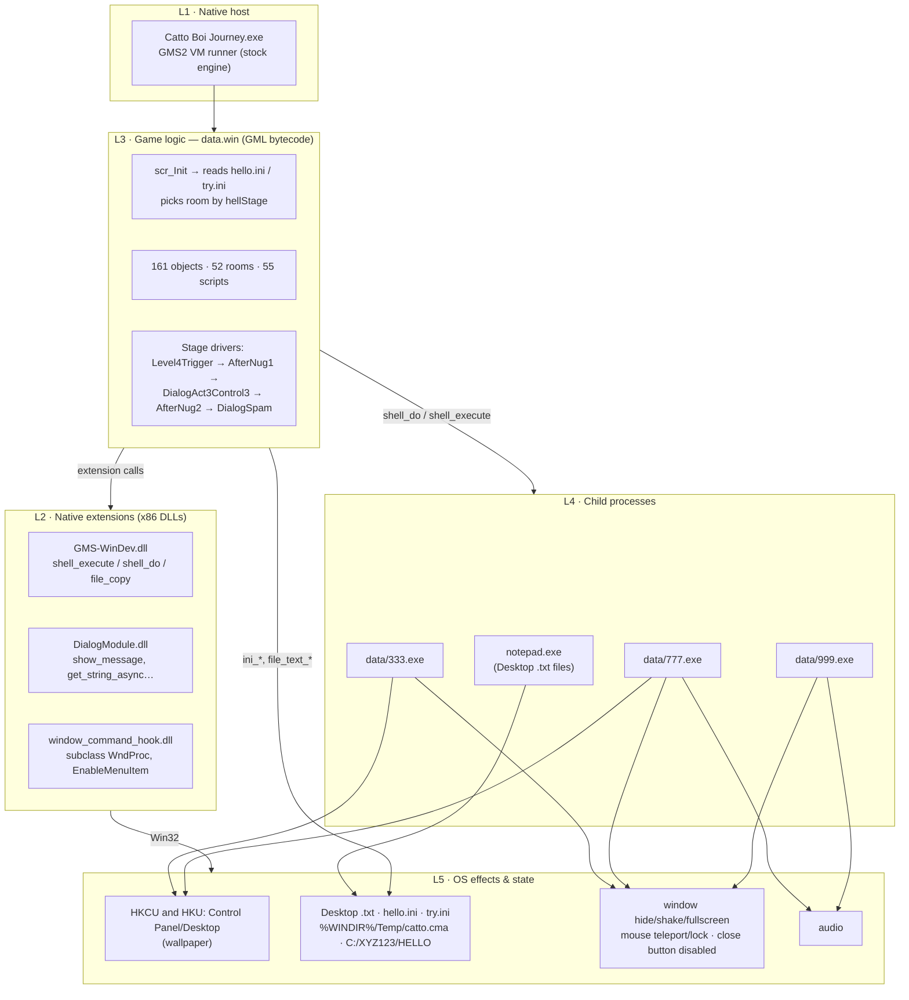

# Catto Boi: Journey to Catto Land v1.2.1.0 — reverse-engineering report

A full static teardown of a "normal-looking" GameMaker horror game that reaches outside its window:
it opens Notepad, drops text files on the Desktop, locks and teleports the mouse, hides and shakes its
own window, intercepts the close button, and (via helper games) changes the Windows wallpaper.

**Links**

* Game page (GameJolt): <https://gamejolt.com/games/Cat/1104230>
* Gameplay video (IShowSpeed, YouTube): <https://www.youtube.com/watch?v=ZsZLCnsCrIs>

**Verdict.** The game does what its `readme.txt` says, and a bit more than that readme admits. It is a
scripted "meta-horror" game, not a virus: no network code, no persistence keys, no self-copying, no
Task Manager/shutdown tricks. It is, however, *intrusive*: the full list of effects is in
[§4](#4-everything-it-does-to-your-machine) and a cleanup guide is in [§8](#8-cleanup--reset).

> **Method.** Everything below comes from static analysis; I did not run any game binary. Where this
> report states something about runtime behaviour, it is either read straight from decompiled code, or
> it was cross-checked against files and registry values already left on this PC by an earlier play
> session (read-only, [§7](#7-checked-against-a-real-run)). Unverified items are called out in [§10](#10-limits-and-open-questions).

---

## 1. What is in the package

| File | Size | SHA-256 | What it is |
|---|---:|---|---|
| `Catto Boi Journey.exe` | 5,072,896 | `d2d26a7b395ef486d3d373931091f222397ca9dc0e5082aac7cde9b106275d55` | GameMaker **Studio 2 VM runner**, x86, PE built 2020-08-14. Version info: *Tamago-iku*, v1.2.1.0, © 2021. **Not signed** (see note below). |
| `data.win` | 62,381,632 | `ab8b30bdc557d8cc47ddfd92be349ae387f5470d9acb1bcee302ebdaa10e7d40` | All game content and logic as GML **bytecode v17** (stamped 2021-07-22). Project `Catto_Boi_Journey`, 1280×720, debug flag set. |
| `GMS-WinDev.dll` | 87,552 | `fc86c4f3…bd524266` | GM extension: thin wrappers over `ShellExecuteA`, `CopyFileA`, `Sleep`, `fopen`. |
| `window_command_hook.dll` | 91,136 | `97c0d475…63f55461` ¹ | GM extension (YellowAfterlife's library): subclasses the game window to intercept `WM_SYSCOMMAND`. |
| `DialogModule.dll` | 196,608 | `ccce3ddf…83947369` | GM extension: native message/question/input dialogs (sync + async). |
| `data/333.exe` | 4,256,689 | `d95d936cecc376172376c546e8008bb925b312868afdccb583e5ee12dc04d17f` | **GameMaker 8.1** game, run as a separate process. |
| `data/777.exe` | 21,034,172 | `0cb5d3988e12c886530d3f0c804fee55c9068311df648377183b56785a337c50` | GameMaker 8.1 game (embeds ~18 MB of audio). |
| `data/999.exe` | 20,720,135 | `5cf2092f5c1e8bf341a3f34d5da36a50727f9abfccb07fde34440585f44c7ca9` | GameMaker 8.1 game (embeds ~17 MB of audio). |
| `data/img/spook.png` | — | `7df56cb7…c6213` | Byte-identical to the `spook.png` embedded in `777.exe`/`999.exe`. Never referenced by the main game's code. |
| `options.ini`, `readme.txt` | — | — | Runner sleep margin; the author's disclaimer. |

¹ full hash: `97c0d4759e12b6b50e48cec270a9bc4bbb6e7011cf2fb912805131bd63f55461`.

**Signature note (correction).** My first PE triage reported "Authenticode present" for the main exe.
That was wrong: the certificate-table entry in the PE header is non-zero but points at an all-zero
`WIN_CERTIFICATE` header — a stale leftover — and Windows reports the file as `NotSigned`. So there is
no signature to vouch for the runner. I scanned it for persistence, shell, download and destructive
indicators instead ([§11](#11-what-it-does-not-do-and-how-i-checked)).

---

## 2. The layers

The game is a stack. Each layer only reaches the OS through the one below it.



| Layer | Component | Where the real logic lives | Decompiled by |
|---|---|---|---|
| L1 | GMS2 VM runner | It is an interpreter: it contains **no game logic**. All behaviour is in L3. | not decompiled (stock engine); imports and strings audited |
| L2 | 3 extension DLLs | Tiny: 67 / 97 / 315 non-library functions | IDA 9.3 + Hex-Rays, and `rea` ([§9](#9-how-this-was-done)) |
| L3 | `data.win` | 600 GML code entries, 161 objects, 52 rooms, 55 scripts, 3 extensions | GMExplorer's `Gm/` decompiler core |
| L4 | `333/777/999.exe` | One object (`obj_MouseFuck`) each, ≈10 lines of GML | OpenGMK `gm8decompiler` + a `gm8exe` port |
| L5 | Files, registry, window, audio | Not code: the observable effects | verified against a real run |

---

## 3. L3 — the game logic

### 3.1 Boot and the progress state machine

`scr_Init` ([`gml_Script_scr_Init.gml`](analysis/gms-datawin/code/gml/gml_Script_scr_Init.gml)) runs
at start-up:

1. `scr_CheckState()` reads `hello.ini` → `stage`, `fakeEnd`, `theEnd` (defaults 0).
2. `scr_CheckTry()` reads `try.ini` → `trying` (default 0).
3. Reads `USERNAME` from the environment into `global.Username`.
4. `scr_InitMisc()` sets the window caption/lives/character *by stage*.
5. Picks the first room:

| State (`hello.ini`) | Window caption | First room |
|---|---|---|
| `theEnd = 1` | `Thank you <USERNAME>` | `rm_Warning` (46) |
| `fakeEnd = 1` | default (`dreaming` once `try.ini` has reached 2) | `rm_IMSORRY` (18) and `try.ini` is incremented each launch; once it has reached 2 → `rm_Act6Dialog1` (3) |
| `stage = 1` | `Catto Boi: Journey to Catto Land` | `rm_DEAD` (0) |
| `stage = 2` | `The Adventures of Catto Boi` | `rm_Warning` (46) |
| `stage = 3` | `Catto Boi's Bizarre Adventure` | `rm_Warning` (46) |
| `stage = 4` | `Catto Boi: Journey to Catto Land` | `rm_Progression` (28) — the "enter the code" puzzle |
| `stage = 5` | `I'M SORRY…` (repeated), lives = `"I'M SORRY"`, character = 666 | `rm_Warning` (46) |
| fresh install | `Catto Boi: Journey to Catto Land` | `rm_Warning` (46) |

Each stage ends the same way: write text files → pop Notepad / spawn a helper game → `scr_writeHellStage(n)`
→ `scr_ExitGame()` (the process quits, so the next launch is a new stage). The writers:

| Writes | Code entry | What the player sees just before |
|---|---|---|
| `stage = 1` | `obj_Level4Trigger` Alarm 0/1 | `DIEDIEDIEDIEDIEDIE.txt` on the Desktop, opened in Notepad |
| `stage = 2` | `obj_AfterNug1` Alarm 2 | window hidden, dialog `DDDD…`, **launches `777.exe`**, writes `punish.txt` |
| `stage = 3` | `obj_DialogAct3Control3` Alarm 7/8 | `I AM IMMORTAL.txt` (opened) and `illusion.txt` |
| `stage = 4` | `obj_AfterNug2` Alarm 1 | "deja vu?" dialogs, `find me.txt`, plants `C:\XYZ123\HELLO\WELL DONE.txt` |
| `stage = 5` | `obj_DialogSpam` Alarm 1 | **launches `999.exe`**, launches Notepad on `WHY.txt` every 0.5 s for 10 s (≈20 launches), writes `no more.txt` |
| `fakeEnd = 1` | `rm_IMSORRY` creation code | the fake ending room; also deletes the lock file |
| `fakeEnd = 0`, `theEnd = 1` | `obj_Understood` Alarm 1 | "what if this was all just a dream…?" → true ending, caption `Thank you <USERNAME>` |

`obj_StartControl` (the stage-1 "you're back" scene) is the one that **launches `333.exe`**:
*"you're back once again / I'm now in your world, `<USERNAME>` / I can do things like this:"*.
How the player moves between these scenes inside a stage depends on gameplay I did not execute, so
treat the stage-internal ordering as inferred, and the table above as exact.

### 3.2 The code puzzle (spoiler)

After stage 4 the game asks *"have you found it?"* (`obj_StartControl2`), then
`get_string_async("what's the code?")` (`obj_DialogTest`) and compares your answer to the literal string
**`64 65 61 64`** — the hex bytes of ASCII `dead`, the content of the planted `WELL DONE.txt`.
Right answer → `"well done… the following events will test your true potential"` → `rm_Warning`.
Wrong → `"so you lied to me… you truly are pathetic"` → exit. "No" → `"keep trying…"` → exit.

### 3.3 Run-time "fourth wall" effects in the main game

| Effect | Code | Notes |
|---|---|---|
| Mouse pinned to the top-left every step | `obj_MouseLock` Step: `display_mouse_set(0, 0)` | created by `rm_Darkness`, `rm_Hell`, `rm_LevelWho`, `rm_LevelWhy`, `rm_More` |
| *(dead code)* mouse teleport | `obj_MouseFuck` Step: `display_mouse_set(random(1000), random(1000))` | defined in `data.win` but never instantiated or referenced anywhere. The mouse-teleport effect is live only in the helper games, which reuse the name |
| Window thrown around the desktop | `obj_ScreenShake` Step: `window_set_position(x, y + random(-300..300))` | created by `obj_ShakeTrigger` |
| Window hidden / shown | `window_set_visible_w(0/1)` ×27 → `ShowWindow(SW_HIDE/SW_SHOW)` | used across stage transitions |
| Fullscreen forced on/off | `window_set_fullscreen` ×28 | |
| Close button / Alt+F4 neutralised | `obj_CloseHandler`: `window_command_hook(0xF060)` + `window_command_set_active(0xF060, 0)` | `0xF060` = `SC_CLOSE`; see §5.3 |
| Single-instance guard | `obj_CloseHandler` → `scr_OneProcess` | lock file `%WINDIR%\Temp\catto.cma` (content `DIENOW`) |
| Personalisation | `environment_get_variable("USERNAME")` (stored once in `global.Username`) | `illusion.txt`, `really.txt`, dialogs, window captions |
| Path lookups | `environment_get_variable("windir")` / `("USERPROFILE")` (23 `environment_get_variable` calls in total) | Notepad path, Desktop path, lock-file path |

There are also developer-only rooms (`rm_DebugMenu`, `rm_GlobalVarMenu`, `rm_Act1Menu`, `rm_Test`,
`rm_Test2`, `rm_example`) and extension demo objects (`obj_test`, `obj_example`). The debug menus only lead
to each other and include a "Test fake crash" entry. `obj_test`, which has buttons for `shell_do`,
`shell_execute`, `file_text_put/get` and `file_copy_win`, is never placed or created. None of this is on
the story path ([Appendix C.4](#c4-dead-code-and-unreachable-content)).

---

## 4. Everything it does to your machine

| # | Effect | Mechanism | From |
|---|---|---|---|
| 1 | **Opens Notepad** on Desktop text files | `shell_execute(%WINDIR%/notepad.exe, %USERPROFILE%\Desktop\<file>)` → `ShellExecuteA` | `obj_Level4Trigger`, `obj_BlackBoi`, `obj_BlackBoi2`, `obj_DialogAct3Control3`, `obj_Entity`, `obj_DialogSpam`, `obj_Wait` (opens the bundled `readme.txt`) |
| 2 | **Writes text files** to the Desktop *and* a second copy via `working_directory` (lands in the save folder) | `scr_writeTextFile` → `file_text_open_write` | **Appendix A** (all 15, verbatim) |
| 3 | **Writes a file into another directory** | `scr_writeTextToDir(…, "C:\XYZ123\HELLO")` — `WELL DONE.txt` | `obj_AfterNug2` |
| 4 | **Launches 3 helper games** | `shell_do("open", <exe dir>\data\333/777/999.exe)` → `ShellExecuteA` | `obj_StartControl`, `obj_AfterNug1`, `obj_DialogSpam` |
| 5 | **Changes the wallpaper** | helper games write `Control Panel\Desktop\Wallpaper` etc. + `rundll32 user32.dll,UpdatePerUserSystemParameters` | `333.exe`, `777.exe` only (§6) |
| 6 | Teleports / pins the mouse | `display_mouse_set` | main game (`obj_MouseLock`) and all three helpers |
| 7 | Plays loud audio | `audio_play_sound` / `sound_play` | main game, `777.exe`, `999.exe` |
| 8 | Hides, shakes, resizes the window; disables its Close | `ShowWindow`, `SetWindowPos`, subclassed WndProc, `EnableMenuItem` | main game |
| 9 | Stores progress | `hello.ini`, `try.ini` in the save area | `scr_write*` |
| 10 | Creates then deletes a lock file | `%WINDIR%\Temp\catto.cma` | `scr_OneProcess`, `scr_ExitGame`, `rm_IMSORRY` |
| 11 | Reads `USERNAME`, `USERPROFILE`, `windir` | `environment_get_variable` | text/dialog personalisation, paths |
| 12 | Writes a temp image and deletes it on exit | GM8 "included file → temp folder, remove at end" | `333.exe`, `777.exe`, `999.exe` |

**Text files the game writes** (short gist; the full list, exact contents, triggers and timings are in **[Appendix A](#appendix-a--every-text-file-and-marker-file-the-game-writes)**):
`DIEDIEDIEDIEDIEDIE.txt` (DIE ×11) · `punish.txt` ("catto is now gone…") · `I AM IMMORTAL.txt`
("deleting this game will not end it") · `illusion.txt` ("nothing is what it seems `<USERNAME>`") ·
`find me.txt` (points you at a hidden file on C:) · `listentome.txt`, `hey.txt` (a friendly NPC) ·
`sorry.txt`, `really.txt`, `WHY.txt` (apologies from the helper character) · `no more.txt` · `keep trying.txt` ·
`it can't be over can it.txt` · and `I'MSORRYI'MSORRYI'MSORRYI'MSORRYI'MSORRYI'MSORRY<N>.txt`,
written by `obj_TextSpam` every 0.25 s for 4 s (~16 files).

---

## 5. L2 — the extension DLLs

All three were decompiled in full ([`analysis/native/`](analysis/native/)). Each GML-visible function is
a thin wrapper; there is no hidden logic.

### 5.1 `GMS-WinDev.dll` — exports exposed to GML (11)

| GML function | Implementation | Used by the game? |
|---|---|---|
| `shell_do(op, file)` | `ShellExecuteA(0, op, file, 0, 0, SW_SHOWNORMAL)` | yes — launches helper games |
| `shell_execute(file, params)` | `ShellExecuteA(0, 0, file, params, 0, SW_SHOWNORMAL)` | yes — Notepad |
| `shell_do_at`, `shell_do_ext`, `shell_execute_at` | `ShellExecuteA` variants | no |
| `file_copy_win(src, dst)` | `CopyFileA(src, dst, FALSE)` | only the debug `obj_test` (path chosen in a file dialog) |
| `file_text_get/put` | `fopen`/`fread`/`fputs` | only `obj_test` |
| `delay(ms)` | `Sleep(ms)` | only `obj_test` |
| `get_color_win`, `window_set_caption_ext` | `ChooseColorA`, `SetWindowTextA` | only `obj_test` |

(`shell_open` is exported by the DLL but not registered with the extension, so GML cannot call it.)

### 5.2 `DialogModule.dll`

A dialog library (message/question/input/file/colour pickers, sync and `_async`) built on `MessageBoxW`,
`GetOpenFileNameW`, `SHBrowseForFolderW`, `ChooseColorW`, GDI+ icons, and a CBT hook
(`SetWindowsHookExA`) to restyle its own dialogs. It has **no network, registry, or process-spawning
imports**. The game uses `show_message`, `show_question_async`, `get_string_async`, and
`widget_set_caption/owner` to put text such as *"I can do whatever I want, whenever I want"* in front of
you with custom captions.

### 5.3 `window_command_hook.dll`

Stock library. The window procedure it installs
(`SetWindowLongW(hWnd, GWL_WNDPROC, …)`, [`sub_100011B0`](analysis/native/window_command_hook.dll.c)):

```c
if (Msg == WM_SYSCOMMAND /*0x112*/ && !running_internally) {
    cmd = wParam & 0xFFFFFFF0;
    if (cmd in disabled_set) return 1;               // swallowed
    if (cmd in hooked_set)  { triggered[cmd] = 1; return 1; }   // swallowed, flag for GML
}
return CallWindowProcW(original, hWnd, Msg, wParam, lParam);
```

`window_command_set_active(0xF060, 0)` → `EnableMenuItem(GetSystemMenu(hWnd), SC_CLOSE, MF_GRAYED)`.
Net effect in this game: the title-bar X is greyed, `SC_CLOSE` is intercepted, and Alt+F4 (which also
arrives as `SC_CLOSE`) goes nowhere. The game's own exit paths are `scr_ExitGame` or killing the process.
It imports only `USER32` window APIs and the CRT.

### 5.4 Cross-check

`rea` (via IDA) returns the same pseudocode and assembly for the key exports; its Evidence files are in
[`analysis/native/rea/`](analysis/native/rea/).

---

## 6. L4 — the three GameMaker 8.1 helper games

The three `.exe` files in `data/` are the stock GM8.1 (Delphi) runner plus an appended, encrypted game.
They share the runner code and the same GM project id (`857117616`): one template, three variants. Each
has **one room** (640×480, 60 fps) containing a single **invisible** (`window_set_visible(false)`)
instance of `obj_MouseFuck`. Full output: [`analysis/gm8/`](analysis/gm8/) (`*-src/*.gml` as text,
`*.gm81` openable in the GM8.1 IDE).

| | `333.exe` | `777.exe` | `999.exe` |
|---|---|---|---|
| Mouse, every step | `display_mouse_set(random(3000), random(3000))` | `(random(4000), 20)` → top edge | `(random(2000), 500)` |
| Audio | none | `snd_WHATTHEFUCK` loop (≈17.5 MB WAV), then `snd_Scream` | `snd_ReverseTitle` (≈17.2 MB WAV) |
| Wallpaper | **`creep.png`** at +1 s | **`spook.png`** at +13.3 s (alarm 800) | **none** |
| Quits after | 240 steps (4 s) | +100 steps after the wallpaper (≈15 s total) | 1200 steps (20 s) |
| Embedded image | `creep.png` (165,257 B) | `spook.png` (25,849 B) | `spook.png` (25,849 B, unused) |

The wallpaper code (identical in `333.exe` and `777.exe`, only the file name differs):

```gml
registry_set_root(0) // HKEY_CURRENT_USER
registry_write_string_ext('Control Panel\desktop','Wallpaper', temp_directory + "\spook.png")
registry_write_string_ext('control panel\desktop','stretchwallpaper', '0')
registry_write_string_ext('control panel\desktop','TileWallpaper','0')
registry_write_string_ext('control panel\desktop','wallpaperstyle','2')   // 2 = stretch
sleep(20)
registry_set_root(3) // HKEY_USERS
registry_write_string_ext('.default\Control Panel\desktop','Wallpaper', temp_directory + "\spook.png")
... (same three style keys)
sleep(20)
execute_shell('RUNDLL32.EXE','user32.dll, UpdatePerUserSystemParameters',);
```

Two consequences worth knowing:

* The `HKEY_USERS\.DEFAULT` write targets the *default/logon* profile and needs admin rights; on a
  normal account it silently fails. Only the `HKCU` write takes effect.
* The image is an "included file → temp folder, **remove at end**". The helper game deletes
  `…\Temp\gm_ttt_NNNNN\<image>.png` when it exits, so the registry value is left pointing at a file
  that no longer exists. Nothing in the game ever restores the wallpaper.

The loose `data/img/spook.png` on disk is not referenced by any code in any layer; the helpers use their
own embedded copies.

---

## 7. Checked against a real run

The PC this was analysed on had already been played into stage 1 (before I started), which allowed
read-only checks of the decompiled logic. They all matched:

| Prediction from the code | Observed |
|---|---|
| Stage 1 writes `hello.ini` with `stage=1` | `hello.ini` = `[progress]` / `stage="1.000000"` |
| `scr_writeTryCount(0)` writes `try.ini` | `try.ini` = `[keep]` / `trying="0.000000"` |
| `DIEDIEDIEDIEDIEDIE.txt` on the Desktop **and** a copy in the save folder | both present |
| Save folder is the GameMaker save area | `%LOCALAPPDATA%\Catto_Boi_Journey\` — **not** the `Catto_Boi_Tuna` named in the shipped `readme.txt` |
| A helper game wrote the wallpaper keys | `HKCU\Control Panel\Desktop`: `Wallpaper` = `…\Temp\gm_ttt_<n>\spook.png`, `WallpaperStyle`=2, `TileWallpaper`=0, `StretchWallpaper`=0 |
| `HKU\.DEFAULT` write fails without admin | value absent |
| Temp image removed at exit | `…\gm_ttt_<n>` folder gone → wallpaper value points at a missing file |
| Lock file left behind if the game is killed | `%WINDIR%\Temp\catto.cma` (`DIENOW`) present while no game process ran → **the game will exit immediately on next launch until that file is deleted** |

---

## 8. Cleanup / reset

Nothing here is destructive, but none of it is automatic either. In PowerShell:

* If the game quits instantly, delete the stale lock:

  ```powershell
  Remove-Item "$env:WINDIR\Temp\catto.cma"
  ```

* Replay from the start (resets stage, fake-end, try-count and the text copies):

  ```powershell
  Remove-Item "$env:LOCALAPPDATA\Catto_Boi_Journey\*"
  ```

* Wallpaper: pick any picture in *Settings → Personalization → Background*. That rewrites the
  `Wallpaper` value, replacing the dangling temp path.

* Desktop litter: the `.txt` files in §4, including the numbered `I'MSORRY…<N>.txt` series. Also remove
  `C:\XYZ123` if it exists.

---

## 9. How this was done

| Task | Tool |
|---|---|
| Native triage, evidence-backed function analysis | **REA** (`rea-agents` 6.5.0, source @ `18aa9af`) using its **IDA provider** |
| Disassembly / decompilation of the DLLs | **IDA Professional 9.3** (build 260213) + Hex-Rays, headless via `idalib` and `ida-pro-mcp` 2.0.0 @ `c133c38` (the commit REA documents as known-working) |
| `data.win` → GML | **GMExplorer** `Gm/` core (`GmData`, `Bytecode`, `Decompiler`, `Textures`, `PeFile`), compiled **unmodified** into a headless dumper ([`tools/CattoDump`](tools/CattoDump)). I added an `EXTN` parser, since GMExplorer keeps only extension names |
| GM8.1 helpers → GML | OpenGMK `gm8decompiler` v2.2.0 (built 2024-02-12, zip SHA-256 `a68a4cdbd455a2164885c8d854e5f7891324043cddad19b80bf1d9c4d958a860`) for the `.gm81` projects; plus [`tools/Gm8Dump`](tools/Gm8Dump), a C# port of the `gm8exe` read path (`@9e4282e`) for readable text. The Rust build failed here (no Windows SDK), so the release binary was used |
| String/indicator scans | [`tools/scan_strings.py`](tools/scan_strings.py), [`tools/triage_pe.py`](tools/triage_pe.py), [`tools/overlay.py`](tools/overlay.py) |

**Zydis** was not needed. GMExplorer's Zydis-based `gmnative` reads machine code of *YYC-compiled*
games; this one is VM bytecode (`CODE` chunk, 600 entries), and IDA/Hex-Rays covered the only native code
that carries game-specific behaviour (the DLLs).

**Reproduce:**

```powershell
dotnet run --project tools/CattoDump -- "<game>\data.win" analysis\gms-datawin
dotnet run --project tools/Gm8Dump  -- "<game>\data\333.exe" analysis\gm8\333-src
python tools\ida_dump.py "<copy of dll>" analysis\native      # IDADIR must point at IDA
python tools\scan_strings.py "<game>\Catto Boi Journey.exe"
```

`CattoDump.csproj` references `GMExplorer\Gm\*.cs` by absolute path; edit `GmCore` to match your checkout.

### 9.1 File index

```
analysis/
  gms-datawin/   summary · strings · functions (149 distinct calls) · variables · objects · rooms
                 · extensions · code-index · code/gml (600 decompiled) · code/asm (600 raw)
  gm8/           333/777/999.gm81 (openable in GM8.1)  ·  *-src/{objects,rooms,scripts}.gml · overview · included/*.png
  native/        GMS-WinDev.dll.c · window_command_hook.dll.c · DialogModule.dll.c · rea/*.json (Evidence)
tools/           the helper programs above
```

Note: the decompiler writes `gml_Script_<name>.gml` (the function body) *and*
`gml_GlobalScript_<name>.gml` (the wrapper) for GMS2.3 scripts.

---

## 10. Limits and open questions

* **Not executed by me.** §7 relies on artefacts from a previous play session, not on a monitored run.
* **Coverage.** Every `data.win` code entry (600/600) and every GM8 event/script/room was decompiled; the
  decompiler's output is best-effort GML (it prints some object ids numerically, e.g. `23.alarm[3]`,
  and a few room names for rooms that no longer exist in the project). The stock **runners** (GMS2 and
  GM8.1) were not decompiled: they hold engine code, not game logic, and were audited by imports and
  strings only. I cannot prove they are byte-identical to YoYo Games' / GameMaker 8.1's, because the
  main exe is unsigned and I had no reference build to diff.
* **Stage-internal ordering** (which scene follows which inside one stage) is inferred; the stage
  writers and the boot logic are exact.
* **Unverified runtime details:** that the runner auto-creates `C:\XYZ123\HELLO` when asked to write
  there (no `directory_create` is called); whether Windows still shows the old cached wallpaper after
  the temp image is deleted; exact audio durations.
* **Antivirus.** The detections the author mentions are plausible heuristics: an unsigned exe that calls
  `ShellExecute`, edits wallpaper registry keys, spawns Notepad, and hides/subclasses its window looks
  like a dropper to a scanner, even though none of the harmful capabilities were found.

## 11. What it does not do, and how I checked

The "virus-like" feel comes from the effects in §4. These are the capabilities malware would need that the
game does **not** have, with the evidence for each.

| Capability | Found? | Evidence |
|---|---|---|
| Network access from game code | **No** | The game's GML calls 149 distinct functions ([`functions.txt`](analysis/gms-datawin/functions.txt)); none is an `http_*`, `network_*`, `url_open`, `os_*`, `clipboard_*`, `buffer_*` or `steam_*` function. No URL appears in the 1,781 strings. None of the three DLLs imports a networking library. (The stock runner *links* WinINet/Winsock because GameMaker has networking features; the game never calls them.) |
| Registry writes from the main game | **No** | No `registry_*` function in the GML; the runner imports only the read-side registry APIs (`RegOpenKeyExW`, `RegQueryValueExW`, `RegCloseKey`). The only registry writes anywhere are in the helper games, to `Control Panel\Desktop` (§6) |
| Persistence (Run keys, scheduled tasks, services, Startup folder) | **No** | Nothing in the GML or helper games writes outside `Control Panel\Desktop`; string scans of the runner and all three DLLs found none of `CurrentVersion\Run`, `schtasks`, `\Startup\`, `Winlogon` |
| Shutdown, logoff, Task Manager or policy changes | **No** | No such calls or strings. The scan hits for "shutdown" are Steam-API/audio-queue shutdown strings in the stock runner; "CScript" is an internal C++ class name |
| Deleting or modifying your files | **No** | `file_delete` is called with exactly one target, its own lock file `%WINDIR%\Temp\catto.cma`. No `file_find_*`, `directory_destroy` or similar. The helper games delete only their own extracted temp images. It does *create* files (Appendix A) |
| Copying itself / spreading | **No** | `file_copy_win` exists only in `obj_test`, which is never placed or created (C.4) |
| Launching downloaded or arbitrary code | **No** | `shell_do`/`shell_execute` targets are fixed: `notepad.exe` under `%WINDIR%`, the three bundled helper exes under `<game>\data\`, and the bundled `readme.txt`. The helpers run `RUNDLL32.EXE user32.dll, UpdatePerUserSystemParameters`. Verb is `open` / default, never `runas` |
| Needing admin rights | **No** | Everything works as a normal user; the one admin-only write (`HKEY_USERS\.DEFAULT`) simply fails (§7) |
| Collecting or sending your data | **No** | It reads `USERNAME`, `USERPROFILE`, `windir` and uses them locally (C.5). With no network code there is nowhere to send them |
| Disabling security tools | **No** | No process enumeration, no service or driver calls, no AV-related strings |

**How this was checked:** the full GML call inventory (above), the string/indicator scans in
[`tools/scan_strings.py`](tools/scan_strings.py) over the runner and every DLL, a manual import review of each
binary, the complete Hex-Rays decompilation of the three DLLs (§5), the complete decompilation of the helper
games (§6), and the real-run artefacts in §7.

**What this does not prove:** the stock runners were audited by imports and strings only, not decompiled, and
the main exe is unsigned (§1), so I cannot rule out a tampered runner byte-for-byte. Everything the game
*does* in practice is explained by `data.win`, the DLLs and the helper games, which I did decompile.

---

## Appendix A — every text file and marker file the game writes

### A.1 Every text file the game writes

All `scr_writeTextFile` files are written **twice**: to `%USERPROFILE%\Desktop\<name>` and to `working_directory\<name>`, which GameMaker redirects into the save folder (`%LOCALAPPDATA%\Catto_Boi_Journey\<name>`, confirmed by a real copy of `DIEDIEDIEDIEDIEDIE.txt` there).

| # | File name | Written by (object · event) | Delay set up by that event | Opened in Notepad by |
|--:|---|---|---|---|
| 1 | `punish.txt` | `obj_AfterNug1` · Alarm_2 | — | not opened automatically |
| 2 | `find me.txt` | `obj_AfterNug2` · Alarm_1 | — | not opened automatically |
| 3 | `hey.txt` | `obj_BlackBoi2` · Create_0 | — | `obj_BlackBoi2` · Alarm_0 |
| 4 | `listentome.txt` | `obj_BlackBoi` · Create_0 | — | `obj_BlackBoi` · Alarm_0 |
| 5 | `I AM IMMORTAL.txt` | `obj_DialogAct3Control3` · Alarm_7 | alarm 8 = 30 | `obj_DialogAct3Control3` · Alarm_8 |
| 6 | `illusion.txt` | `obj_DialogAct3Control3` · Alarm_8 | — | not opened automatically |
| 7 | `no more.txt` | `obj_DialogSpam` · Alarm_1 | — | not opened automatically |
| 8 | `sorry.txt` | `obj_Entity` · Create_0 | alarm 0 = 240 | `obj_Entity` · Alarm_0 |
| 9 | `really.txt` | `obj_Entity` · Create_0 | alarm 0 = 240 | `obj_Entity` · Alarm_1 |
| 10 | `WHY.txt` | `obj_Entity` · Create_0 | alarm 0 = 240 | `obj_DialogSpam` · Alarm_0 |
| 11 | `DIEDIEDIEDIEDIEDIE.txt` | `obj_Level4Trigger` · Alarm_0 | alarm 1 = 120 | `obj_Level4Trigger` · Alarm_1 |
| 12 | `I'MSORRYI'MSORRYI'MSORRYI'MSORRYI'MSORRYI'MSORRY<N>.txt` (N = 1…16) | `obj_TextSpam` · Alarm_0 | alarm 0 = 15 | not opened automatically |
| 13 | `it can't be over can it.txt` | `obj_Timer2` · Create_0 | alarm 0 = 1200 | not opened automatically |
| 14 | `keep trying.txt` | `obj_Timer` · Create_0 | alarm 0 = 600 | not opened automatically |
| 15 | `WELL DONE.txt` → **`C:\XYZ123\HELLO`** (a separate folder, not the Desktop) | `obj_AfterNug2` · Alarm_1 | — | not opened automatically |

### A.2 Verbatim contents

`⏎` marks a line break inside the file; `<USERNAME>` is the Windows `USERNAME` environment variable.

**1. `punish.txt`** — `obj_AfterNug1` · Alarm_2 → Desktop + save folder

```text
catto is now gone 
there is no hope anymore 
he said he'd do far worse and now look
```

**2. `find me.txt`** — `obj_AfterNug2` · Alarm_1 → Desktop + save folder

```text
there is a file hidden within your C: drive that contains a piece of code 
this code is needed to finish what you've started 
as I said, there is no rush, take all the time you need 
and don't ask for help unless it's really necessary
```

**3. `hey.txt`** — `obj_BlackBoi2` · Create_0 → Desktop + save folder

```text
hey 
remember me?
```

**4. `listentome.txt`** — `obj_BlackBoi` · Create_0 → Desktop + save folder

```text
I tried to help last time 
but I couldn't 
and I'm sorry 
but this time it will be different 
I'll help you stop him once and for all 
I don't want to run away...
```

**5. `I AM IMMORTAL.txt`** — `obj_DialogAct3Control3` · Alarm_7 → Desktop + save folder

```text
if you think deleting this game will end it all 
you're wrong 
there is NO ESCAPE FROM ME
```

**6. `illusion.txt`** — `obj_DialogAct3Control3` · Alarm_8 → Desktop + save folder

```text
nothing is what it seems <USERNAME>
```

**7. `no more.txt`** — `obj_DialogSpam` · Alarm_1 → Desktop + save folder

```text
no more
```

**8. `sorry.txt`** — `obj_Entity` · Create_0 → Desktop + save folder

```text
I sabotaged everything 
I'm so sorry 
I didn't think he would see me... 
I didn't think he would notice... 
I'M SORRYYYYYYYYYYYYYYYYYYYYYYYYYY
```

**9. `really.txt`** — `obj_Entity` · Create_0 → Desktop + save folder

```text
He has finally won <USERNAME>
I can't do anything anymore 
There is no escape anymore
```

**10. `WHY.txt`** — `obj_Entity` · Create_0 → Desktop + save folder

```text
I'm sorry...
```

**11. `DIEDIEDIEDIEDIEDIE.txt`** — `obj_Level4Trigger` · Alarm_0 → Desktop + save folder

```text
DIEDIEDIEDIEDIEDIEDIEDIEDIEDIEDIE
```

**12. `I'MSORRYI'MSORRYI'MSORRYI'MSORRYI'MSORRYI'MSORRY<N>.txt`** — `obj_TextSpam` · Alarm_0 → Desktop + save folder

```text
I'MSORRYIREALLYAM 
IT'SALLMYFAULT 
JUSTENDITALLLLLLLLLLLLLL 
I'MSORRYI'MSORRYI'MSORRYI'MSORRYI'MSORRYI'MSORRYI'MSORRYI'MSORRYI'MSORRYI'MSORRYI'MSORRYI'MSORRY 
I'MSORRYI'MSORRYI'MSORRYI'MSORRYI'MSORRYI'MSORRYI'MSORRYI'MSORRYI'MSORRYI'MSORRYI'MSORRYI'MSORRY 
I'MSORRYI'MSORRYI'MSORRYI'MSORRYI'MSORRYI'MSORRYI'MSORRYI'MSORRYI'MSORRYI'MSORRYI'MSORRYI'MSORRY 
I'MSORRYI'MSORRYI'MSORRYI'MSORRYI'MSORRYI'MSORRYI'MSORRYI'MSORRYI'MSORRYI'MSORRYI'MSORRYI'MSORRY 
I'MSORRYI'MSORRYI'MSORRYI'MSORRYI'MSORRYI'MSORRYI'MSORRYI'MSORRYI'MSORRYI'MSORRYI'MSORRYI'MSORRY 
I'MSORRYI'MSORRYI'MSORRYI'MSORRYI'MSORRYI'MSORRYI'MSORRYI'MSORRYI'MSORRYI'MSORRYI'MSORRYI'MSORRY 
I'MSORRYI'MSORRYI'MSORRYI'MSORRYI'MSORRYI'MSORRYI'MSORRYI'MSORRYI'MSORRYI'MSORRYI'MSORRYI'MSORRY
```

**13. `it can't be over can it.txt`** — `obj_Timer2` · Create_0 → Desktop + save folder

```text
can't 
keep 
trying 
getting 
weaker 
guilt 
shame
```

**14. `keep trying.txt`** — `obj_Timer` · Create_0 → Desktop + save folder

```text
keep trying
```

**15. `WELL DONE.txt`** — `obj_AfterNug2` · Alarm_1 → C:\XYZ123\HELLO

```text
64 65 61 64
```

### A.3 Non-`.txt` marker and state files

| File | Written by | Content / format | Purpose |
|---|---|---|---|
| `hello.ini` (save folder) | `scr_writeHellStage`, `scr_writeFakeEnd`, `scr_writeTrueEnd` | `[progress]` with `stage`, `fakeEnd`, `theEnd` (reals; GameMaker writes them as `"1.000000"`). A key only exists once its writer has run. A missing file is treated as `stage=0 fakeEnd=0 theEnd=0` | progress / ending flags |
| `try.ini` (save folder) | `scr_writeTryCount` (every launch, from `scr_Init`) | `[keep]` / `trying=<n>` | counts launches after the fake ending; at 2 the dream sequence starts |
| `%WINDIR%\Temp\catto.cma` | `scr_OneProcess` (at `obj_CloseHandler` creation) | the text `DIENOW` | single-instance lock: if it already exists the game quits at once. Deleted by `scr_ExitGame` and `rm_IMSORRY`. A killed game leaves it behind |
| `%WINDIR%\Temp\1.cma`, `%WINDIR%\Temp\2.cma` | **nothing in `data.win` creates them** | — | read by `obj_Locked` in `rm_Lock` to draw a `0/2` / `1/2` counter (see Appendix C.1) |
| `C:\XYZ123\HELLO\WELL DONE.txt` | `obj_AfterNug2` · Alarm_1 | `64 65 61 64` | the answer to the stage-4 code prompt |
| `<Temp>\gm_ttt_<n>\creep.png` / `spook.png` | the GM8.1 helpers (extracted at start, deleted at exit) | PNG, 165,257 B / 25,849 B | the wallpaper images |

### A.4 Debug-only files (not on the story path)

`obj_test` (an extension demo; **it is not placed in any room and never created by code, so it cannot run in this build**) would write `test.txt` containing `Hello World!` through `file_text_open_write` and open it in Notepad; its `file_text_put` button would write `WinDev.txt` containing the current date/time, and `file_text_get` would read it back in a dialog. Both would go to the save folder. Listed for completeness only.

### A.5 Timing of the noisy sequences

Delays come from the `alarm[n] = …` values in the code (steps). Seconds assume 60 steps/s, GameMaker's usual rate; this build never calls `game_set_speed`, so if it runs at 30 steps/s every time doubles.

| Sequence | What happens, in order | Total |
|---|---|---|
| Stage 1 end (`obj_Level4Trigger`) | write `DIEDIE…txt` + play a sound → **+120 steps (2 s)** → Notepad opens it, `stage=1`, process exits | 2 s |
| Stage 2 end (`obj_AfterNug1`) | window hidden **+120 steps (2 s)** → window shown, black overlay **+5 steps** → dialog `DDDD…`, window hidden, **`777.exe` launched**, `punish.txt` written, `stage=2`, exit | ≈2 s + dialog |
| Stage 3 end (`obj_DialogAct3Control3`) | `I AM IMMORTAL.txt` written, window hidden → **+30 steps (0.5 s)** → `stage=3`, Notepad opens it, `illusion.txt` written, exit | 0.5 s |
| Stage 4 end (`obj_AfterNug2`) | window hidden **+120 steps (2 s)** → caption `deja vu?`, window shown **+5 steps** → 5 dialogs, `find me.txt` + `C:\XYZ123\HELLO\WELL DONE.txt` written, `stage=4`, exit | ≈2 s + dialogs |
| Stage 5 end (`obj_Entity` → `obj_DialogSpam`) | `sorry.txt`, `really.txt`, `WHY.txt` written at once → **+240 (4 s)** Notepad `sorry.txt` → **+180 (3 s)** Notepad `really.txt` → **+240 (4 s)** `obj_DialogSpam`: **`999.exe` launched**, Notepad `WHY.txt` **every 30 steps (0.5 s)** → **+600 (10 s)** `no more.txt` written, `stage=5`, exit | ≈21 s, ≈20 Notepad launches at the end |
| File flood (`obj_TextSpam`) | one new `I'MSORRY…<N>.txt` **every 15 steps (0.25 s)**; the object destroys itself at 240 steps | ≈4 s, 15–16 files |
| `obj_Timer` | `keep trying.txt` written → **+600 steps (10 s)** → `scr_ExitGame` | 10 s |
| `obj_Timer2` | `it can't be over can it.txt` written → **+1200 steps (20 s)** → `room_goto(20)` (`rm_Act6Dialog2`) | 20 s |
| NPC `obj_BlackBoi` | `listentome.txt` written when it spawns; when the player touches it → **+120 steps (2 s)** → Notepad opens it | 2 s after touch |
| NPC `obj_BlackBoi2` | `hey.txt` written when it spawns; on touch → **+60 steps (1 s)** → Notepad opens it, `obj_Ending` created | 1 s after touch |
| `rm_Lock` (`obj_Wait`) | **+600 steps (10 s)** → Notepad opens the bundled `readme.txt` from the game folder | 10 s |


## Appendix B — every popup and caption shown outside the game

Order inside a block is the order of the calls in the code. `show_message` is a blocking OS message box from `DialogModule.dll`; `*_async` ones return an id and answer in an Async-Dialog event.

**`obj_AfterNug1` · Alarm_2**

- message: “DDDDDDDDDDDDDDDDDDDDDDDDDDDDDDDDDDDDDDDDDDDDDDDDDDDDDDDDDDDD”

**`obj_AfterNug2` · Alarm_1**

- message: “feel familiar to you?”
- message: “I know it's familiar to me”
- message: “look at your desktop, I dropped another little text file for you”
- message: “this time you're on your own - take your time, there is no rush”
- message: “once you're done, come back and we'll make further arrangements on how this should end”

**`obj_AfterShake` · Alarm_0**

- message: “I AM IMMORTAL I AM IMMORTAL I AM IMMORTAL I AM IMMORTAL I AM IMMORTAL I AM IMMORTAL I AM IMMORTAL I AM IMMORTAL ”

**`obj_DialogAct3Control3` · Alarm_4**

- message: “and if you think you can stop me”
- message: “you have no idea...”
- message: “I could delete your entire fucking system and you wouldn't even realise”
- message: “I'm not fucking around <USERNAME>”
- message: “just you wait and see...”

**`obj_DialogTest` · Alarm_0**

- text prompt: “what's the code?”

**`obj_StartControl2` · Alarm_1**

- yes/no question: “have you found it?”

**`obj_StartControl2` · Alarm_2**

- message: “I'll take your word for it...”
- message: “just to test you, I'll ask you to put in the code in the following dialog box.”

**`obj_StartControl2` · Alarm_3**

- message: “well done...”
- message: “the following events will test your true potential”

**`obj_StartControl2` · Alarm_4**

- message: “so you lied to me...”
- message: “you truly are pathetic”

**`obj_StartControl2` · Other_63**

- message: “keep trying...”

**`obj_StartControl` · Alarm_2**

- message: “you're back once again”
- message: “I'm now in your world, <USERNAME>”
- message: “just remember”
- message: “I can do”
- message: “whatever I want”
- message: “whenever I want”
- message: “I can do things like this:”

**`obj_StartControl` · Alarm_3**

- message: “I can do far worse you know”
- message: “don't cross the line with me <USERNAME>”

**`obj_Understood` · Alarm_0**

- message: “what if this was all just a dream...?”
- message: “what if I'm ok...?”
- message: “<USERNAME>?”
- message: “am I ok...?”
- message: “I feel like I'm waking up...”

**Window / dialog captions set by the game**

- dialog title (DialogModule) → “DDDDDDDDDDDDDDDDDDDDDDDDDDDDDDDDDDDDDDDDDDDDDDDDDDDDDDDDDDDD” — `obj_AfterNug1` · Alarm_2
- dialog title (DialogModule) → “deja vu?” — `obj_AfterNug2` · Alarm_0
- dialog title (DialogModule) → “I AM IMMORTAL” — `obj_AfterShake` · Alarm_0
- dialog title (DialogModule) → “so” — `obj_DialogTest` · Alarm_0
- dialog title (DialogModule) → “progression” — `obj_StartControl2` · Alarm_1
- window title → “eternity” — `obj_StartControl2` · Create_0
- dialog title (DialogModule) → “eternal” — `obj_StartControl` · Alarm_1
- dialog title (DialogModule) → “DIEDIEDIEDIEDIEDIEDIEDIEDIEDIEDIEDIE” — `obj_ToLoadScreen` · Collision_obj_PlayerControl
- window title → “Thank you <USERNAME>” — `obj_Understood` · Alarm_1
- window title → “Thank you <USERNAME>” — `script:scr_InitMisc`
- window title → “dreaming” — `script:scr_InitMisc`
- window title → “The Adventures of Catto Boi” — `script:scr_InitMisc`
- window title → “Catto Boi's Bizarre Adventure” — `script:scr_InitMisc`
- window title → “I'M SORRYI'M SORRYI'M SORRYI'M SORRYI'M … (99 chars)” — `script:scr_InitMisc`
- window title → “Catto Boi: Journey to Catto Land” — `script:scr_InitMisc`

_In addition, `scr_InitMisc` sets the window title by stage (see §3.1) and the main menus print further text in-game through `scr_Text`, `scr_TextXY`, `scr_TextSmall`, `scr_TextSmallXY` (≈175 call sites); all literals are in `analysis/gms-datawin/strings.txt`._

## Appendix C — more hidden mechanics and leftovers

### C.1 `rm_Lock`: a "0/2" lock that nothing can unlock

`rm_Lock` (room 32) contains two objects:

* `obj_Locked` draws a counter in the corner of the screen every frame:
  `0/2` when neither `%WINDIR%\Temp\1.cma` nor `%WINDIR%\Temp\2.cma` exists, `1/2` when only `1.cma`
  exists, and **nothing at all** when `2.cma` exists (there is no `2/2` branch and no code that leaves the room).
* `obj_Wait` waits 600 steps (≈10 s) and then opens the **bundled `readme.txt`** from the game folder in
  Notepad. This is how the author's disclaimer ends up on screen from inside the game.

Nothing in `data.win` ever creates `1.cma` or `2.cma` (only the *check* exists), and I could not find a path
into the room: no code calls `room_goto(32)`, `obj_NextRoom` (the only `room_goto_next` that would fall
through from room 31) is never placed or spawned, and `obj_NextRoomNoFade` exists only in `rm_Darkness` and
`rm_WakeUp`. Treat `rm_Lock` as an orphaned, unfinished mechanic. If it were reached, the `.cma` extension
matches the game's other marker file (`catto.cma`), which suggests the plan was a two-file external unlock.

### C.2 The close handler samples the keyboard only once

`obj_CloseHandler` is created exactly once, at the end of `scr_Init`, so it lives for the whole session.
In its Create event:

```gml
keyAltF4 = keyboard_check_direct(18) + keyboard_check_direct(115);   // VK_MENU (Alt) + VK_F4
window_command_hook(61536);              // SC_CLOSE: intercept the X button and Alt+F4
window_command_set_active(61536, 0);     // and grey the menu item out
scr_OneProcess();                        // lock file / single instance
```

* The two key states are **added**, so holding *either* Alt *or* F4 while the game starts makes
  `keyAltF4` truthy. (It reads like an `&&` was intended.)
* If it is truthy, Step runs `window_set_fullscreen(0); alarm[0] = 5;` **every frame**. The intended chain
  is Alarm 0 → window hidden → after 180 steps (≈3 s) a sound (`audio_play_sound(3)`) → after 300 more
  steps (≈5 s) `scr_ExitGame`. But `keyAltF4` is set once and never cleared, and Step re-arms `alarm[0] = 5`
  each frame, so Alarm 0 is reset before it can count down to 0. **That hide → sound → exit chain should
  never fire**; the only visible effect of holding Alt or F4 at launch is that fullscreen is forced off every
  step. (Derived from reading the code; I did not run it.)
* After start-up the check is never repeated. Pressing Alt+F4 or clicking X later is simply swallowed by
  `window_command_hook.dll` (§5.3): no dialog, no exit, and nothing in GML polls the "was it clicked" flag.

### C.3 The code prompt is an exact string compare

`obj_DialogTest` compares your answer to the literal `"64 65 61 64"` with `!=`. It is case- and
space-sensitive, so `dead` or `64656164` count as wrong; only the exact string, with single spaces, passes.

### C.4 Dead code and unreachable content

| Item | What it is | Evidence |
|---|---|---|
| `obj_MouseFuck` (main game) | Teleports the mouse every step | Never placed in a room, never created by code. Only the helper games use the name |
| `rm_Lock`, `obj_Locked`, `obj_Wait` | The 0/2 lock, §C.1 | No path found |
| `rm_RedCrash`, `rm_Act2Menu`, `rm_Act3Menu` | Targets of debug-menu entries | Not in this build's room list |
| `rm_DebugMenu`, `rm_GlobalVarMenu`, `rm_Act1Menu` | Developer menus ("Test fake crash", "Exit back to debug menu", …) | They only lead to each other (`room_goto(48/16/33)` come from the debug menus themselves); nothing in the story enters them |
| `rm_Test`, `rm_Test2`, `rm_example` | Test levels (20 collision blocks + spawn) and a `DialogModule` demo (`obj_example`) | Not entered by story code |
| `obj_test` | Extension demo with buttons for `shell_do`, `shell_execute`, `file_text_put/get`, `file_copy_win`, `delay` | **Not placed in any room and never created by code**, so it is dead code in this build |
| `rm_Hell`, `rm_HubDay`, `rm_TitleScreenBackground` | Story/menu rooms | Never named by a literal `room_goto`; they may be reached via room order or variables, which I did not trace |
| `data/img/spook.png` | Loose copy of the helper games' image | Not referenced by any code |
| `GMS-WinDev.dll`: `shell_open` | Extra export | Not registered with the extension, so GML cannot call it |

### C.5 What the game does with your name

`global.Username` is filled once in `scr_Init` from `environment_get_variable("USERNAME")`. It is used in
`illusion.txt`, `really.txt`, six on-screen pop-ups (Appendix B) and the window title *"Thank you `<USERNAME>`"*
after the true ending. It is never written to `hello.ini`/`try.ini` and never sent anywhere (§11).

### C.6 Build-machine paths inside the helper games

The GM8.1 helpers embed the author's original source-image paths (visible in
`analysis/gm8/*-src/overview.txt`, "included files"). They are ordinary build metadata, not behaviour, and I
have deliberately not repeated them in this report.
